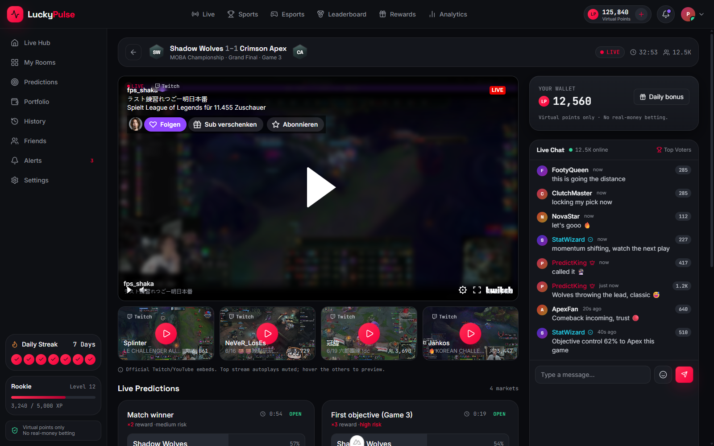
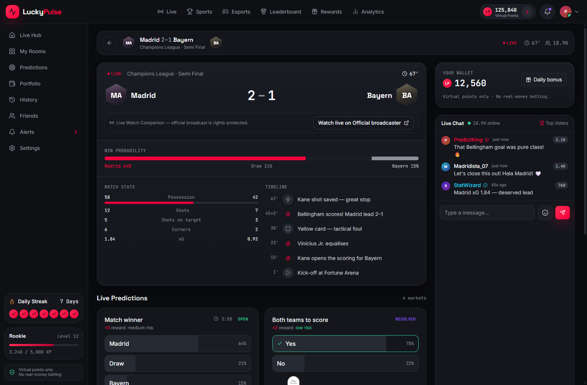
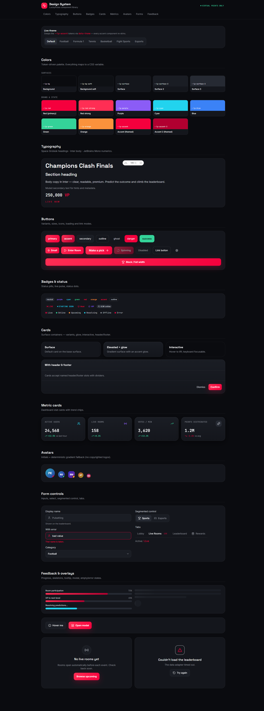
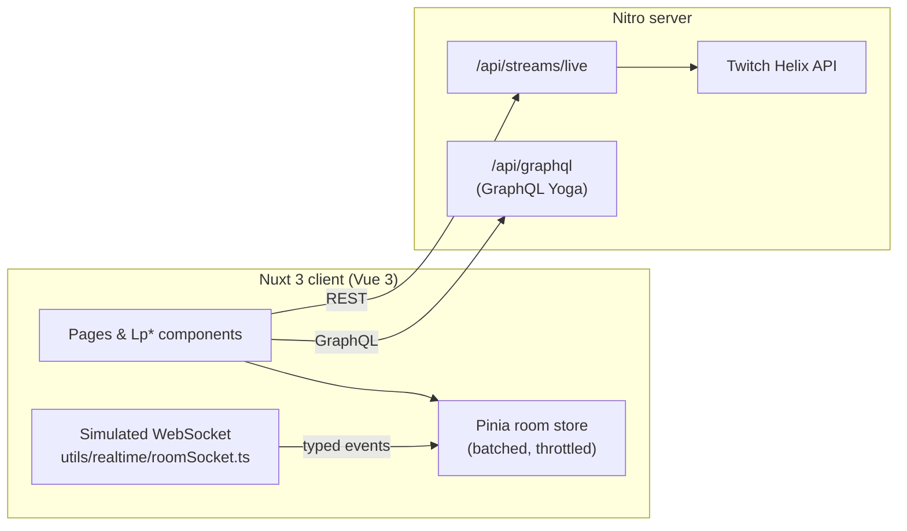

<div align="center">

# LuckyPulse

**Realtime sports & esports prediction rooms with virtual points, live leaderboards and watch companions.**

[](https://nuxt.com)
[](https://vuejs.org)
[](https://www.typescriptlang.org)
[](https://pinia.vuejs.org)
[](https://tailwindcss.com)
[](https://sass-lang.com)
[](https://the-guild.dev/graphql/yoga-server)
[](https://vitest.dev)

</div>

> ⚖️ **Virtual points only. No real-money betting.** No deposits, withdrawals, cash prizes, odds or
> stakes. Streams are official Twitch/YouTube embeds only; licensed sports broadcasts are never
> restreamed. Sports use a live-data Watch Companion plus a deep-link to the official rights-holder.

## About

LuckyPulse is a **Nuxt 3** platform where fans join live prediction rooms for real sports and esports
events, make picks with virtual points, watch official live streams (esports) or a legal data-driven
**Watch Companion** (sports), and climb realtime leaderboards. It was built to demonstrate senior-level
frontend engineering across the Nuxt ecosystem: a token-driven design system, a typed realtime state
layer, SSR, and a server layer with REST and GraphQL.

## Screenshots

| Esports room with live Twitch stream | Sports room with Watch Companion |
| --- | --- |
|  |  |

<details>
<summary><b>Design system page</b> (tall screenshot)</summary>



</details>

## Features

- **Live Hub** (`/live`): featured live match hero, category tiles that open live rooms, top
  prediction rooms, starting-soon list, global leaderboard, live chat, daily-spin preview and realtime stats.
- **Prediction rooms** (`/rooms/[roomId]`): esports rooms with live Twitch video, sports rooms with the
  Watch Companion. Interactive prediction markets with optimistic picks, live countdowns and
  resolution, a virtual-points wallet, leaderboard, chat and activity feed.
- **Categories**: Football, Formula 1, Tennis, Fight Sports, and a first-class Esports section.
- **Design system** (`/dashboard/design-system`): the full component library with live theme switching.

## Engineering highlights

- **Token-driven design system.** A single SCSS token layer feeds the Tailwind theme, so the entire
  app re-skins from one source. A `data-theme` attribute swaps sport/esport accents without
  conditional classes. 16 custom, accessible, SSR-safe `Lp*` base components, documented on a living
  `/dashboard/design-system` page.
- **Realtime engine.** A simulated WebSocket emits a typed event stream (clock, scores, market
  countdowns and resolution, sentiment drift, chat, leaderboard deltas) into a **Pinia store** that
  batches updates, **throttles the leaderboard re-sort to at most once per second**, keeps optimistic
  picks, awards virtual points on correct resolution, and tears subscriptions down on route leave.
  The connection lifecycle includes a capped exponential-backoff reconnect.
- **Legal live-stream strategy.** Esports rooms embed **real live Twitch channels**, auto-discovered
  server-side via the Twitch Helix API (the secret stays in Nitro, never on the client; a curated
  fallback is used when unconfigured). Sports, whose broadcasts can't be legally embedded, get a
  **Watch Companion**: live score, win probability, head-to-head stats and a match timeline, plus a
  deep-link to the official broadcaster. `StreamEmbed` lazy-loads via `IntersectionObserver`: the
  featured player autoplays muted, the rest play on hover.
- **REST + GraphQL.** Simple actions go through Nitro REST routes; richer dashboard reads go through
  a **GraphQL Yoga** endpoint (`/api/graphql`) with a browsable GraphiQL playground.
- **Performance-minded.** SSR public pages, lazy media, skeleton states, capped lists,
  `prefers-reduced-motion` support, reduced glow on mobile, self-hosted fonts, and a layout that scales
  from laptop to ultrawide.
- **Typed and tested.** Strict TypeScript end-to-end and **28 unit/component tests** (Vitest + Vue Test Utils).

## Tech stack

| Area | Choice |
| --- | --- |
| Framework | Nuxt 3, Vue 3 `<script setup>`, TypeScript (strict) |
| State | Pinia (normalized realtime room store) |
| Styling | Tailwind CSS v3 + SCSS design tokens |
| Backend (MVP) | Nitro server routes (REST) + GraphQL Yoga, mocked-but-architected adapters |
| Realtime | Simulated WebSocket service (swappable for a real WS) |
| Integrations | Twitch Helix (live streams), Watch Companion data adapters |
| API client | Bruno collection (`/bruno`) for the REST + GraphQL endpoints |
| Tooling | Vitest, Vue Test Utils, ESLint, Prettier, `@nuxt/fonts`, `@nuxt/icon`, VueUse |

## Architecture



The simulated socket exposes the same `connect` / `disconnect` + `onEvent` / `onState` interface a real
socket would, so it can be replaced with a real WebSocket server without touching the store.

## Getting started

**Prerequisites:** Node 20+ and npm.

```bash
npm install
cp .env.example .env   # optional, see below
npm run dev            # http://localhost:3000
```

The app runs fully without any keys (mock data and a curated stream fallback). To enable **real live
Twitch discovery**, create a free [Twitch developer app](https://dev.twitch.tv/console) (Client Type:
*Confidential*) and set these variables in `.env`:

| Variable | Purpose |
| --- | --- |
| `NUXT_TWITCH_CLIENT_ID` | Twitch app client ID (live-stream discovery) |
| `NUXT_TWITCH_CLIENT_SECRET` | Twitch app client secret |
| `NUXT_SPORT_API_KEY` | Optional: real sports scores for the Watch Companion |

Secrets are read server-side via `runtimeConfig` and never exposed to the client. `.env` is gitignored.

### Scripts

| Script | Purpose |
| --- | --- |
| `npm run dev` | Dev server with HMR |
| `npm run build` | Production build (Nitro) |
| `npm run preview` | Preview the production build |
| `npm run typecheck` | Strict type-check (`nuxt typecheck` / `vue-tsc`) |
| `npm run test` | Run the test suite (Vitest) |
| `npm run lint` | ESLint (`lint:fix` to auto-fix) |
| `npm run format` | Prettier |

## Testing

```bash
npm run test
```

Covers the design-system component contracts (`LpButton`, `LpBadge`, `LpMetricCard`) and the realtime
store logic (seeding, optimistic picks, reward-on-resolve, leaderboard batching/throttle, chat capping).

## Project structure

```
assets/scss/        design tokens, animations, utilities
components/         ui (Lp* kit) · layout · live · rooms · predictions · events · chat · dashboard
composables/        useLiveHub, useRoom (mock data sources, adapter-shaped)
stores/             room.ts (Pinia realtime store)
server/api/         REST routes (/api/streams/live) + GraphQL Yoga (/api/graphql)
server/utils/       Twitch Helix helper (server-only)
utils/realtime/     simulated WebSocket service
types/              domain + realtime types
tests/              unit + component tests
bruno/              Bruno API collection (REST + GraphQL requests)
```

## Status & roadmap

**Built:** design system, Live Hub, prediction rooms (esports streams + sports companion across four
sports), realtime engine, legal stream strategy with live Twitch integration, REST + GraphQL
endpoints, 28 tests.

**Mocked / next:** real sports data API behind the companion, sports/esports hub pages, performance and
feature-flag dashboards, daily-spin rewards, moderation tools, Playwright E2E, public deployment.

## Legal

This is a fan-engagement and prediction product using **virtual points only**. It is not a betting or
gambling platform: no real money, deposits, withdrawals, cash prizes, odds or stakes. Live video uses
official platform embeds (Twitch/YouTube); licensed sports broadcasts are not restreamed. Users must
follow local laws and platform terms. This README is not legal advice.

---

<div align="center">

Built by [Christoph Barton](https://christophbarton.com) · [More projects](https://github.com/ChristophBarton1)

</div>
